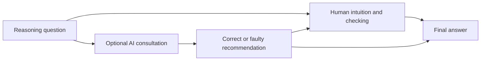

# Cognitive Surrender Guide

An unofficial reading companion to **Thinking—Fast, Slow, and Artificial: How AI is Reshaping Human Reasoning and the Rise of Cognitive Surrender**, by **Steven D. Shaw and Gideon Nave**.

This guide explains the proposed Tri-System Theory, the three behavioral experiments, the within-paper synthesis, and the limits of their interpretation. It is for readers and AI agents. **No research experiments were run, and no results were reproduced here.**

> Research credit: Steven D. Shaw and Gideon Nave, The Wharton School of the University of Pennsylvania. Nave is the corresponding author. The manuscript acknowledges support from the Wharton Behavioral Lab.
>
> Version studied: **v20260111**, as printed on the supplied `ssrn-6097646.pdf`, **58 PDF pages**. [SSRN record](https://papers.ssrn.com/sol3/papers.cfm?abstract_id=6097646) · [DOI](https://doi.org/10.2139/ssrn.6097646). [Official OSF v1 record](https://osf.io/preprints/psyarxiv/yk25n_v1/) · [corresponding public v1 PDF](https://osf.io/download/9gxaq/). The OSF record was published January 12, 2026; the cover version is dated January 11. Public records may change; this guide's page references refer to the attached version.
>
> Maintained by [0xHayd3n](https://github.com/0xHayd3n), with AI assistance. Unaffiliated with, and not endorsed by, the paper's authors.

## The idea in one minute

When a person asks AI for an answer, two different things may happen. They can use the answer as input to their own checking, or accept it with little scrutiny. Shaw and Nave call the latter **cognitive surrender**. Their proposed Tri-System Theory adds external artificial cognition, System 3, to familiar descriptions of intuition (System 1) and deliberation (System 2). The systems are a theoretical account; the experiments measure responses, consultation, and confidence rather than directly observing a mental architecture. [Source: theory and routes, PDF pp. 10–18](docs/01-theory-and-context.md).

The experiments make an AI assistant give either a correct answer or a confident intuitive error to reasoning questions. Participants can consult it or ignore it. Their accuracy improves when the available AI is correct and worsens when it is faulty. This supports the authors' behavioral account of reliance in this setting; it does not uniquely prove that a separate cognitive system exists or that all deliberation stopped.



Original simplified guide diagram, based on the procedure and Figure 1. It shows observable choices and possible checking, not a validated process trace.

## Start reading

| Goal | Module |
| --- | --- |
| Understand System 3, surrender, offloading, and neighboring ideas | [1. Theory and context](docs/01-theory-and-context.md) |
| Understand assignments, AI manipulation, measures, and denominators | [2. Design and analysis](docs/02-design-and-analysis.md) |
| Read the foundational experiment | [3. Study 1](docs/03-study-1.md) |
| Interpret the time-pressure experiment | [4. Study 2](docs/04-study-2.md) |
| Interpret the combined incentives and feedback experiment | [5. Study 3](docs/05-study-3.md) |
| Audit the synthesis, numerical findings, and reporting issues | [6. Synthesis and evidence](docs/06-synthesis-and-evidence.md) |
| Assess implications, limitations, and possible future tests | [7. Limits and discussion](docs/07-limits-and-discussion.md) |
| Locate every section, table, figure, reference list, and appendix reference | [8. Complete source map](docs/08-source-map.md) |
| Use an AI agent | [AGENTS.md](AGENTS.md), [LLMS.txt](LLMS.txt), [claim index](metadata/claims.json) |

Short route: README → theory → Study 1 → limits. Evidence route: design → all three studies → synthesis → source map. Keep the exact PDF beside the guide; page numbers are one-based PDF pages.

## What the experiments report

These are author-reported measurements, not this repository's findings. Availability, actual consultation, and user-profile subgroups have different denominators.

| Report | Essential scope | Location in attached PDF |
| --- | --- | --- |
| Study 1 accuracy: 45.8% Brain-Only, 71.0% AI-Accurate, 31.5% AI-Faulty | Main laboratory sample N=359. AI-trial means include trials on which available AI was not consulted. | pp. 21–25; Figures 2–3 |
| Faulty recommendations followed on 79.8% of consulted Study 1 faulty trials | Conditional on consultation, not 79.8% of all people or all AI trials. | p. 22 |
| Study 1 global confidence: 77.0 with AI access versus 65.3 without | Access comparison, not trial-specific confidence after each wrong answer. | p. 25 |
| Study 2 time pressure lowers accuracy; outcomes among frequent AI users strongly track AI correctness | N=485; 30-second deadline; usage profiles are selected behavior, not randomized groups. | pp. 27–33; Figures 5–6 |
| Study 3 faulty-AI override: 42.3% with incentives plus feedback versus 20.0% control | N=450; consulted faulty trials; the two intervention components cannot be separated. | pp. 33–35; Figure 7 |
| Pooled accurate-versus-faulty contrast OR=16.07, 95% CI [11.50,22.46] | Reported synthesis N=1,372, 9,593 trials, including an ancillary Study 1 online sample. OR describes odds, not a 16-fold probability. | pp. 41–44 |

Confidence intervals and important null interactions appear in the individual modules and [structured results](metadata/results.json). Several sample/count/effect-size details cannot be reconciled from the attached manuscript alone; see the [reporting audit](docs/06-synthesis-and-evidence.md#reporting-audit).

## Coverage and provenance

The **actual attached PDF** was read through Library, including its full text from pages 1–58, tables, figure captions, and references. The Windows binary materialization helper failed at extended-attribute handling; there is no verified local PDF hash. No public PDF was substituted for the attached content. Library image requests returned pointers rather than viewable pixels. An auxiliary official OSF v1 PDF with the same cover stamp, title, authors, 58-page count, and reference endpoint was obtained to inspect Tables 1–2 and Figures 1–10. Its bytes differ in size from the attachment, so binary equality is not claimed. Quantitative entries use the attached written values, not estimates from chart bars.

The attachment ends with references on pages 51–58. **Web Appendices A–D and Tables W1–W3 are cited by the manuscript but are not included in it.** The guide maps their stated purpose without inventing their contents. The official OSF preprint links a [materials/preregistration project](https://osf.io/n84tx), but its API returned 401 Unauthorized on October 20, 2026; the public preprint inventory contains only the main PDF. Exact prompts, exclusions, and preregistration details remain dependent on those external materials. [Source register](metadata/sources.json) · [paper metadata](metadata/paper.json) · [verification scope](VERIFICATION.md).

## Agent use

Read [AGENTS.md](AGENTS.md) first. A useful prompt is:

```text
Explain Study 3 using docs/05-study-3.md and the attached v20260111 source.
Separate randomized interventions, selected consultation behavior, and theoretical interpretation.
For each number give the study, denominator, PDF page, and uncertainty when reported.
Preserve missing-supplement and reporting-audit caveats. Do not claim replication.
```

## Cite and credit

Cite **Shaw and Nave (2026)** for the research. [CITATION.cff](CITATION.cff) and [BibTeX](references/paper.bib) include both authors and identify the studied manuscript version. The original guide material is licensed under [CC BY 4.0](LICENSE); this grant does not cover the source paper or third-party material. No source PDF, full text, original figure, dataset, or author code is redistributed. [Attribution](ATTRIBUTION.md) explains the boundary.

## Check and maintain

```bash
python scripts/validate_repository.py
```

The check covers documentation and metadata integrity, local links, anchors, citation consistency, and source-page ranges. It does not validate psychological theories, reproduce statistics, or authenticate preregistration. See [CONTRIBUTING.md](CONTRIBUTING.md) for corrections.
